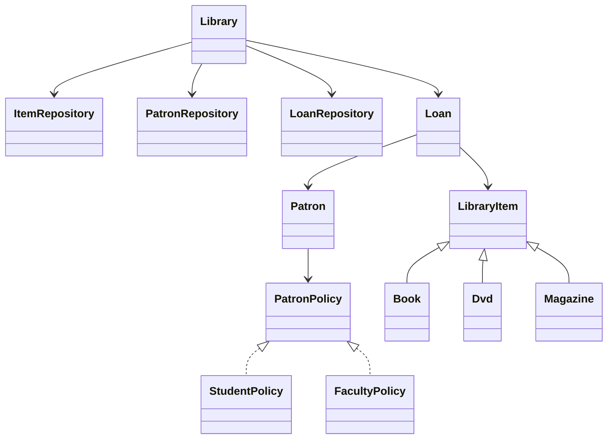

# Library Management

Java 25 and Maven library domain model for registration, borrowing, returns and fines.

## Packages

- model: items, patrons and loans
- policy: student and faculty rules
- repository: storage interfaces and in-memory implementations
- service: library operations
- factory: item creation
- exception: domain failures

Run tests with `mvn test`.

## Usage

```java
Library library = new Library(new InMemoryItemRepository(),
            new InMemoryPatronRepository(), new InMemoryLoanRepository());
    library.addItem(new Book("b1", "Clean Code"));
    library.registerPatron(new Patron("p1", "Ali", new StudentPolicy()));
    Loan loan = library.borrow("p1", "b1", LocalDate.of(2026, 11, 15));
library.returnItem("b1", loan.getDueDate());
```

Import classes from com.library.model, policy, repository and service, plus java.time.LocalDate. calculateFine previews an active loan's fine; payFine settles it.

## Class diagram


